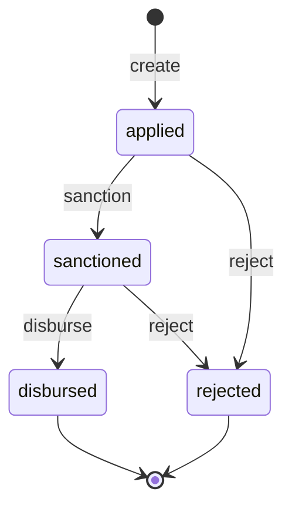

# Customer loan state machine

<!-- Generated from packages/domain/src/state-machines by `pnpm --filter @shakti/domain machines:docs`. Do not edit by hand. -->

`customer_loans.state`. Loan status can gate payment milestones and dispatch (`gates_json`).

Sources: BLUEPRINT §8.1, §19 item 2; PRD CRM-08; DATABASE §6.2 `customer_loans`.

Items marked *proposed* are not named in the governing documents; they were chosen for this specification and need review.

## States

| State | Kind | Notes |
|---|---|---|
| `applied` | initial | – |
| `sanctioned` | – | – |
| `disbursed` | terminal | – |
| `rejected` | terminal | – |

## Transitions

| Event | From → To | Permitted actor | Guard | Effects | Emits |
|---|---|---|---|---|---|
| `create` | (new) → `applied` | `crm.account.write` | – | – | `crm.loan.created` |
| `sanction` | `applied` → `sanctioned` | `crm.account.write` | the amount is recorded and above zero | `set_amount`: record the sanctioned amount; `release_gates`: release the dispatch and milestones gated on `sanctioned` (`crm.loan.gates_released`) | `crm.loan.sanctioned` |
| `disburse` | `sanctioned` → `disbursed` | `crm.account.write` | the amount is recorded and above zero | `release_gates`: release the dispatch and milestones gated on `disbursed` (CRM-08, `crm.loan.gates_released`) | `crm.loan.disbursed` |
| `reject` *(proposed)* | `applied`, `sanctioned` → `rejected` | `crm.account.write` | a reason is given | `notify_owner`: tell the opportunity owner so another route can be offered | `crm.loan.rejected` |

Any other event, or an event from a state not listed for it, answers `conflict` with reason `customer_loan_transition_not_allowed`. A guard that refuses answers its own reason; the permission check answers `forbidden`. The command writes the new state to `customer_loans.state` and the time to `customer_loans.state_changed_at` when the state changes, applies the effects and calls `ctx.audit()`, and emits the event in the *Emits* column ([event catalogue](../data/events.md)).

## Notes

- `create`: Against one order, in the order's company and for its customer; one active loan per order.

## Diagram

