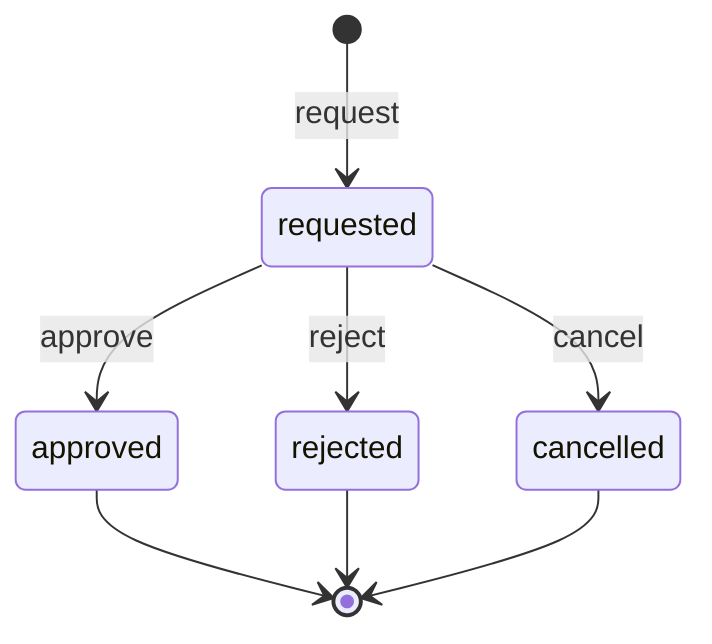

# Leave request state machine

<!-- Generated from packages/domain/src/state-machines by `pnpm --filter @shakti/domain machines:docs`. Do not edit by hand. -->

`leave_requests.state`. Leave of one type over a span of days for one person on the staff. A person asks for their own; HR may ask for anyone. An approver decides it in their scope (the people they manage at team scope, the company, or every company), never their own; the person who asked takes it back while it waits.

Sources: docs/03-roadmap-appendix/phase5.md §5; PRD HR-02; DATABASE §6.8 `leave_requests`.

Every state and transition comes from the governing documents.

## States

| State | Kind | Notes |
|---|---|---|
| `requested` | initial | – |
| `approved` | terminal | – |
| `rejected` | terminal | – |
| `cancelled` | terminal | – |

## Transitions

| Event | From → To | Permitted actor | Guard | Effects | Emits |
|---|---|---|---|---|---|
| `request` | (new) → `requested` | `hr.leave.request` | – | – | – |
| `approve` | `requested` → `approved` | `hr.leave.approve` at team scope or wider | the approver is not the person whose leave it is | `use_balance`: take the days off the balance, once; `record_decision`: record who approved it and when | `hr.leave.approved` |
| `reject` | `requested` → `rejected` | `hr.leave.approve` at team scope or wider | the approver is not the person whose leave it is | `record_decision`: record who rejected it and when | – |
| `cancel` | `requested` → `cancelled` | `hr.leave.request` | the caller asked for the leave, or it is their own | `record_decision`: record when it was taken back | – |

Any other event, or an event from a state not listed for it, answers `conflict` with reason `leave_request_transition_not_allowed`. A guard that refuses answers its own reason; the permission check answers `forbidden`. The command writes the new state to `leave_requests.state` and the time to `leave_requests.decided_at` when the state changes, applies the effects and calls `ctx.audit()`, and emits the event in the *Emits* column ([event catalogue](../data/events.md)).

## Notes

- `request`: For someone else’s leave, `hr.employee.write` for every company. The days are the working days of the span by the person’s shift and the holidays; a span with none, or one overlapping a waiting or approved request, is refused.
- `approve`: At team scope, only for the people whose manager is the approver.
- `reject`: At team scope, only for the people whose manager is the approver.

## Diagram

