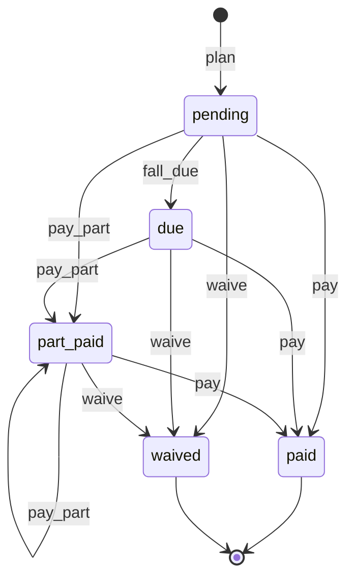

# Payment milestone state machine

<!-- Generated from packages/domain/src/state-machines by `pnpm --filter @shakti/domain machines:docs`. Do not edit by hand. -->

`payment_milestones.state`. One step of an order's payment terms: its share of the total, when it falls due and whether a customer loan may hold it back. An unpaid before-dispatch milestone keeps the order's dispatch from leaving (`app.order_dispatch_payment_gate()`).

Sources: docs/03-roadmap-appendix/phase5.md §5, §6.1, question 6 (a); PRD FIN-01; DATABASE §6.7 `payment_milestones`.

Items marked *proposed* are not named in the governing documents; they were chosen for this specification and need review.

## States

| State | Kind | Notes |
|---|---|---|
| `pending` | initial | Waits for its due rule, or for a customer loan that holds it back. |
| `due` | – | – |
| `part_paid` | – | Tally receipts paid part of it (TC3). |
| `paid` | terminal | – |
| `waived` | terminal | – |

## Transitions

| Event | From → To | Permitted actor | Guard | Effects | Emits |
|---|---|---|---|---|---|
| `plan` | (new) → `pending` | `finance.payment.write` at entity scope or wider or the platform | – | `split`: the order's total shared by the steps: fixed amounts first, then the percentages of the rest, each rounded to the rupee, the last taking what is left, so the milestones add up to the total | – |
| `fall_due` | `pending` → `due` | `finance.payment.write` at entity scope or wider or the platform | its due rule's moment has come (the order confirmed, ready to dispatch, installed, or the days after the invoice passed), and no customer loan holds it back (`app.order_loan_gate()` answers it `pending`) | `set_due_on`: record the day it fell due (IST) | – |
| `pay_part` *(proposed)* | `pending`, `due`, `part_paid` → `part_paid` | the platform only | – | – | – |
| `pay` | `pending`, `due`, `part_paid` → `paid` | the platform only | – | – | – |
| `waive` | `pending`, `due`, `part_paid` → `waived` | `finance.payment.write` at all scope or wider | a reason is given | `set_waiver`: keep who waived it, when and why (audited); a dispatch no longer waits for it | `finance.milestone.waived` |

Any other event, or an event from a state not listed for it, answers `conflict` with reason `payment_milestone_transition_not_allowed`. A guard that refuses answers its own reason; the permission check answers `forbidden`. The command writes the new state to `payment_milestones.state` when the state changes, applies the effects and calls `ctx.audit()`, and emits the event in the *Emits* column ([event catalogue](../data/events.md)).

## Notes

- `plan`: Planned once per order from the company's current terms for its segment (or the named default), by the platform when the order is confirmed or by Accounts by hand.
- `fall_due`: An on-confirmation milestone falls due as it is planned; the dispatch (D2), the installation and the Tally invoice (TC3) bring the others due.
- `pay_part`: A Tally receipt applied to it, short of its amount (TC3).
- `pay`: Tally receipts applied to it reach its amount (TC3).

## Diagram

