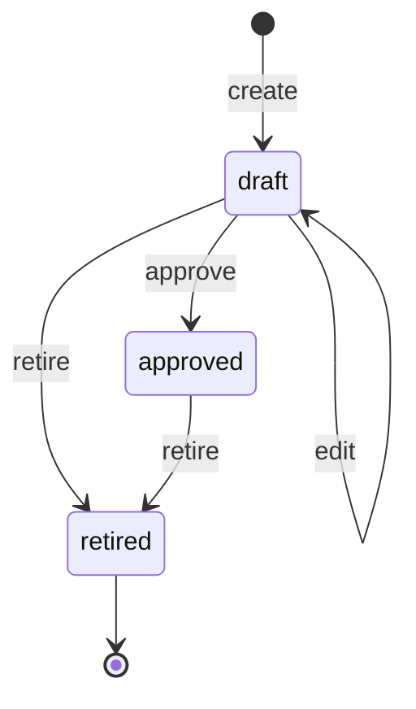

# Playbook directive state machine

<!-- Generated from packages/domain/src/state-machines by `pnpm --filter @shakti/domain machines:docs`. Do not edit by hand. -->

`playbook_directives.state`. Only approved directives steer the agents.

Sources: BLUEPRINT §9.1, §19 item 2; PRD AI-01; DATABASE §6.9 `playbook_directives`; docs/03-roadmap-appendix/phase2.md §5.4.

Every state and transition comes from the governing documents.

## States

| State | Kind | Notes |
|---|---|---|
| `draft` | initial | – |
| `approved` | – | – |
| `retired` | terminal | – |

## Transitions

| Event | From → To | Permitted actor | Guard | Effects | Emits |
|---|---|---|---|---|---|
| `create` | (new) → `draft` | `knowledge.playbook.draft` at all scope or wider or the platform | – | `check_conflicts`: run the conflict check on the wording | `knowledge.playbook.changed` |
| `edit` | `draft` → `draft` | `knowledge.playbook.draft` at all scope or wider | – | `check_conflicts`: clear `conflicts_with` and run the conflict check again | `knowledge.playbook.changed` |
| `approve` | `draft` → `approved` | `knowledge.playbook.approve` at all scope or wider | the conflict check has run on the current wording (`checked_at` is set); no unresolved conflict or overlap with an approved directive (`conflicts_with` is empty) | `set_approver`: set `approved_by` and `approved_at`; `recheck_drafts`: drafts of the same type whose companies overlap are checked again; `emit`: event so the agents and Ask read the approved directives again | `knowledge.playbook.changed` |
| `retire` | `draft` → `retired` | `knowledge.playbook.draft` at all scope or wider | a reason is given | `set_retired`: set `retired_reason` and `retired_at` | `knowledge.playbook.changed` |
| `retire` | `approved` → `retired` | `knowledge.playbook.approve` at all scope or wider | a reason is given | `set_retired`: set `retired_reason` and `retired_at`; `settle_conflicts`: open conflicts naming it are resolved as `other_retired`; `emit`: event so the agents and Ask read the approved directives again | `knowledge.playbook.changed` |

Any other event, or an event from a state not listed for it, answers `conflict` with reason `playbook_directive_transition_not_allowed`. A guard that refuses answers its own reason; the permission check answers `forbidden`. The command writes the new state to `playbook_directives.state` when the state changes, applies the effects and calls `ctx.audit()`, and emits the event in the *Emits* column ([event catalogue](../data/events.md)).

## Notes

- `create`: Drafted by an Executive or a General Manager, or extracted by the Knowledge Brain from a Teach session or a vault file (the platform).
- `retire`: A draft that will not be approved.

## Diagram

