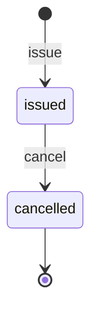

# Proforma state machine

<!-- Generated from packages/domain/src/state-machines by `pnpm --filter @shakti/domain machines:docs`. Do not edit by hand. -->

`proformas.state`. The proforma the BOS issues to ask for payment, per company and financial year with no gaps in its numbers; tax invoices, receipts and credit notes stay in Tally.

Sources: docs/03-roadmap-appendix/phase5.md §5, §6.1, question 3 (a); PRD FIN-01; DATABASE §6.7 `proformas`.

Every state and transition comes from the governing documents.

## States

| State | Kind | Notes |
|---|---|---|
| `issued` | initial | – |
| `cancelled` | terminal | – |

## Transitions

| Event | From → To | Permitted actor | Guard | Effects | Emits |
|---|---|---|---|---|---|
| `issue` | (new) → `issued` | `finance.proforma.write` at entity scope or wider | the order is confirmed, and not closed or cancelled | `snapshot`: copy the order's lines, prices, HSN codes, tax rates and tax split, and its totals, exactly as the order holds them; `number`: draw the next number of the company's `proforma` series for the financial year | `finance.proforma.issued` |
| `cancel` | `issued` → `cancelled` | `finance.proforma.write` at entity scope or wider or the platform | a reason is given | `keep_number`: the number stays used; the series never reuses it; `reprint`: the PDF is printed again with "Cancelled" across it, and replaces the live one | `finance.proforma.cancelled` |

Any other event, or an event from a state not listed for it, answers `conflict` with reason `proforma_transition_not_allowed`. A guard that refuses answers its own reason; the permission check answers `forbidden`. The command writes the new state to `proformas.state` when the state changes, applies the effects and calls `ctx.audit()`, and emits the event in the *Emits* column ([event catalogue](../data/events.md)).

## Notes

- `issue`: One proforma of an order is live at a time; a cancelled one stays beside the next.

## Diagram

