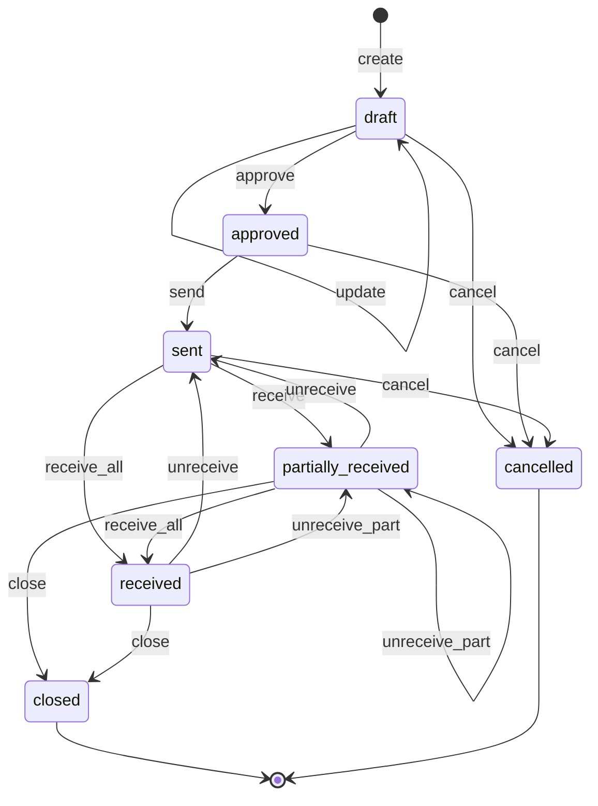

# Purchase order state machine

<!-- Generated from packages/domain/src/state-machines by `pnpm --filter @shakti/domain machines:docs`. Do not edit by hand. -->

`purchase_orders.state`. A purchase order of one company to one vendor for one hub; its rates and amounts are `po_line_rates`, behind `procurement.rate.read`.

Sources: docs/03-roadmap-appendix/phase3.md §7.2; docs/03-roadmap-appendix/phase3.md §2 question 5 (a); BLUEPRINT §8.4; PRD INV-04.

Every state and transition comes from the governing documents.

## States

| State | Kind | Notes |
|---|---|---|
| `draft` | initial | Lines, quantities and rates change; whoever writes the draft becomes its drafter. |
| `approved` | – | Approved within the approver’s limit; ready to send. |
| `sent` | – | With the vendor, by email with its PDF or marked sent by hand; goods may come in. |
| `partially_received` | – | Some goods came in; the rest may come, or the order is short-closed. |
| `received` | – | Every line came in full. |
| `closed` | terminal | – |
| `cancelled` | terminal | – |

## Transitions

| Event | From → To | Permitted actor | Guard | Effects | Emits |
|---|---|---|---|---|---|
| `create` | (new) → `draft` | `procurement.po.write` at entity scope or wider or the platform | the order has at least one line | `number`: `po_no` from the `purchase_order` series; `tax_rates`: each line’s GST rate resolved by the tax engine for its HSN on the day | `procurement.po.drafted` |
| `update` | `draft` → `draft` | `procurement.po.write` at entity scope or wider | the order has at least one line | – | – |
| `approve` | `draft` → `approved` | `procurement.po.approve` at entity scope or wider | every line has its rate and its GST rate; the approver did not draft the order, unless they are an Executive (question 5 (a)); an approver who is not an Executive approves only a grand total including GST below ₹2,00,000 (`WORKSHOP_DEFAULTS.procurement.poApprovalFromRupees`) | – | `procurement.po.approved` |
| `send` | `approved` → `sent` | `procurement.po.write` at entity scope or wider | – | `email_pdf`: by email: the PDF to the vendor’s person through the mailer (worker on the event) | `procurement.po.sent` |
| `receive` | `sent`, `partially_received` → `partially_received` | `procurement.grn.write` at entity scope or wider | – | `stock_in`: `receipt` movements through `app.stock_move()` | `procurement.receipt.posted` |
| `receive_all` | `sent`, `partially_received` → `received` | `procurement.grn.write` at entity scope or wider | – | `stock_in`: `receipt` movements through `app.stock_move()` | `procurement.receipt.posted` |
| `unreceive` | `partially_received`, `received` → `sent` | `procurement.grn.write` at entity scope or wider | – | – | `procurement.receipt.reversed` |
| `unreceive_part` | `partially_received`, `received` → `partially_received` | `procurement.grn.write` at entity scope or wider | – | – | `procurement.receipt.reversed` |
| `close` | `partially_received`, `received` → `closed` | `procurement.po.write` at entity scope or wider | a reason is given | – | `procurement.po.closed` |
| `cancel` | `draft`, `approved`, `sent` → `cancelled` | `procurement.po.write` at entity scope or wider | a reason is given | – | `procurement.po.cancelled` |

Any other event, or an event from a state not listed for it, answers `conflict` with reason `purchase_order_transition_not_allowed`. A guard that refuses answers its own reason; the permission check answers `forbidden`. The command writes the new state to `purchase_orders.state` and the time to `purchase_orders.state_changed_at` when the state changes, applies the effects and calls `ctx.audit()`, and emits the event in the *Emits* column ([event catalogue](../data/events.md)).

## Notes

- `create`: The reorder job (`procurement.reorder.draft`, platform-only) drafts one order per company, preferred vendor and hub, with no rate.
- `update`: A rate is typed or filled from the vendor’s valid quote only under the editor’s own `procurement.rate.read`.
- `receive`: A receipt that leaves some line short.
- `receive_all`: A receipt after which every line is received in full.
- `unreceive`: The reversal of the order’s only receipt still standing.
- `unreceive_part`: The reversal of one receipt while another still stands.
- `close`: Short-closed from partially received: what is still to come is no longer expected.

## Diagram

