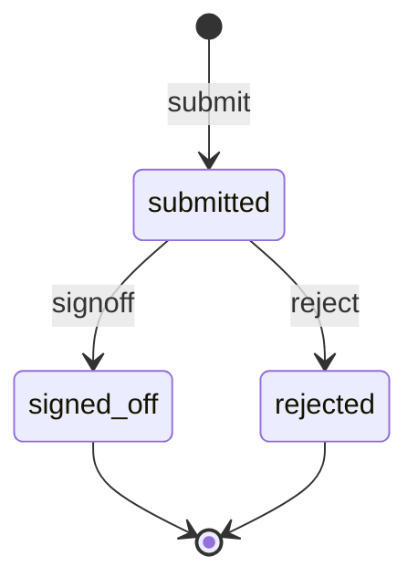

# QC inspection state machine

<!-- Generated from packages/domain/src/state-machines by `pnpm --filter @shakti/domain machines:docs`. Do not edit by hand. -->

`qc_inspections.state`, one row per filled checklist of a project step. A step with a checklist is marked done only once one of its inspections is signed off (`app.project_qc_signed_off()`).

Sources: BLUEPRINT §8.5; PRD PRJ-02 (QC step); phase 4 design §7.3.

Items marked *proposed* are not named in the governing documents; they were chosen for this specification and need review.

## States

| State | Kind | Notes |
|---|---|---|
| `submitted` | initial, *proposed* | – |
| `signed_off` | terminal, *proposed* | – |
| `rejected` | terminal, *proposed* | – |

## Transitions

| Event | From → To | Permitted actor | Guard | Effects | Emits |
|---|---|---|---|---|---|
| `submit` *(proposed)* | (new) → `submitted` | `projects.write` | every item of the checklist is answered, each as its kind asks | – | `projects.qc.submitted` |
| `signoff` *(proposed)* | `submitted` → `signed_off` | `projects.qc.signoff` at entity scope or wider | the person deciding is not the one who submitted it | – | `projects.qc.signed_off` |
| `reject` *(proposed)* | `submitted` → `rejected` | `projects.qc.signoff` at entity scope or wider | the person deciding is not the one who submitted it; a reason is given | – | `projects.qc.rejected` |

Any other event, or an event from a state not listed for it, answers `conflict` with reason `qc_inspection_transition_not_allowed`. A guard that refuses answers its own reason; the permission check answers `forbidden`. The command writes the new state to `qc_inspections.state` and the time to `qc_inspections.decided_at` when the state changes, applies the effects and calls `ctx.audit()`, and emits the event in the *Emits* column ([event catalogue](../data/events.md)).

## Notes

- `submit`: On the open step of a project in progress, on the newest checklist of the project's company and segment for the step; a Field Engineer submits for a project they are on (`own`).
- `signoff`: The step may then be marked done (`projects.milestone.complete`).
- `reject`: A new inspection is submitted for the step.

## Diagram

