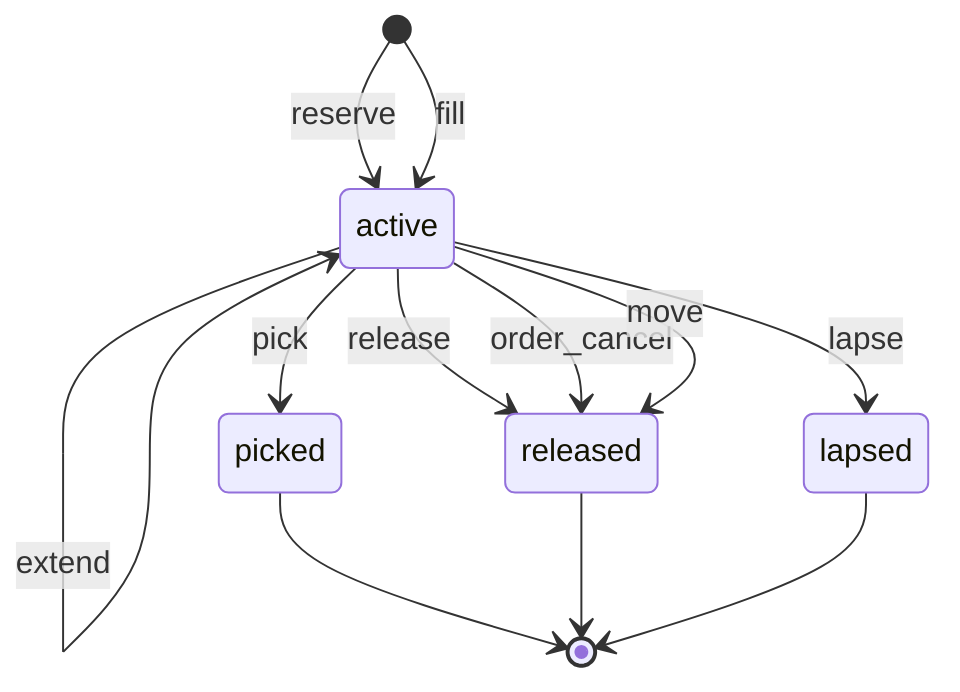

# Reservation state machine

<!-- Generated from packages/domain/src/state-machines by `pnpm --filter @shakti/domain machines:docs`. Do not edit by hand. -->

`reservations.state`, written only by the reservation definers. An active reservation's quantity counts in its bin's `stock_balances.qty_reserved`, so it is not free stock and no outbound movement may take the bin below it (`app.stock_move()`, `stock_reserved_insufficient`). The hold and the reminder before it lapses are `WORKSHOP_DEFAULTS.stock.reservationHoldDays` and `.reservationReminderDays` (STOCK-4).

Sources: docs/03-roadmap-appendix/phase3.md §2 question 3, §5, §7.1; BLUEPRINT §8.4; PRD INV-03, SAL-06.

Items marked *proposed* are not named in the governing documents; they were chosen for this specification and need review.

## States

| State | Kind | Notes |
|---|---|---|
| `active` | initial | Held for the order line in its bin until it lapses, is picked, released or moved. |
| `picked` | terminal | Taken into the hub's dispatch bin for a dispatch (D2). |
| `released` | terminal | Freed by a person, by the order’s cancellation, or moved to another hub. |
| `lapsed` | terminal | Freed when its hold ran out; the quantity is back on order. |

## Transitions

| Event | From → To | Permitted actor | Guard | Effects | Emits |
|---|---|---|---|---|---|
| `reserve` | (new) → `active` | `sales.order.confirm` | – | `reserve`: free stock of the company's storage bins, bin by bin, is added to their `qty_reserved` (`app.stock_reserve()`); what is short is the line's backorder | – |
| `fill` | (new) → `active` | the platform only | – | `reserve`: the new free stock is added to its bins' `qty_reserved` | `inventory.reservation.filled` |
| `extend` | `active` → `active` | the permission of `inventory.stock.adjust` for the company (the Inventory Manager), or `sales.order.cancel` (the General Manager), named by the input | it has not been extended before; a reason is given | `extend`: held one more hold period from its date, with the reason; a new reminder is due before it | `inventory.reservation.extended` |
| `release` | `active` → `released` | `inventory.stock.adjust` at entity scope or wider | a reason is given | `unreserve`: the quantity leaves its bin's `qty_reserved` (`app.stock_unreserve()`), and is back on order unless the order was cancelled | `inventory.reservation.released` |
| `order_cancel` | `active` → `released` | `sales.order.cancel` at entity scope or wider | a reason is given | `unreserve`: the quantity leaves its bin's `qty_reserved` (`app.stock_unreserve()`), and is back on order unless the order was cancelled | – |
| `move` | `active` → `released` | `inventory.stock.adjust` at entity scope or wider | – | `unreserve`: the quantity leaves its bin's `qty_reserved` (`app.stock_unreserve()`), and is back on order unless the order was cancelled; `reserve_elsewhere`: new reservations in the other hub | `inventory.reservation.moved` |
| `lapse` | `active` → `lapsed` | the platform only | – | `unreserve`: the quantity leaves its bin's `qty_reserved` (`app.stock_unreserve()`), and is back on order unless the order was cancelled | `inventory.reservation.lapsed` |
| `pick` *(proposed)* | `active` → `picked` | `inventory.dispatch.write` at entity scope or wider | – | – | – |

Any other event, or an event from a state not listed for it, answers `conflict` with reason `reservation_transition_not_allowed`. A guard that refuses answers its own reason; the permission check answers `forbidden`. The command writes the new state to `reservations.state` and the time to `reservations.state_changed_at` when the state changes, applies the effects and calls `ctx.audit()`, and emits the event in the *Emits* column ([event catalogue](../data/events.md)).

## Notes

- `reserve`: Confirming an order reserves each line's free stock (a kit line, each component), hubs in the order's preferred order: those whose PIN codes list the site's first (`app.reserve_order()`).
- `fill`: Stock entering a storage bin fills the backorders of that item and company in order of confirmation (`inventory.reservation.fill`, `app.fill_backorders()`).
- `release`: By hand, with a reason; the quantity waits behind the backorders already queued.
- `order_cancel`: The order's cancellation (the sales order machine's `release_reservations`): nothing of it stays backordered.
- `move`: Reserved instead from another hub's free stock, whole or not at all, held to the same date (`app.reservation_move()`).
- `lapse`: The daily scan lapses a reservation past `expires_at`; the next backorder in the queue takes its stock (`inventory.reservation.scan`).
- `pick`: D2: picked by scan into the hub's dispatch bin.

## Diagram

