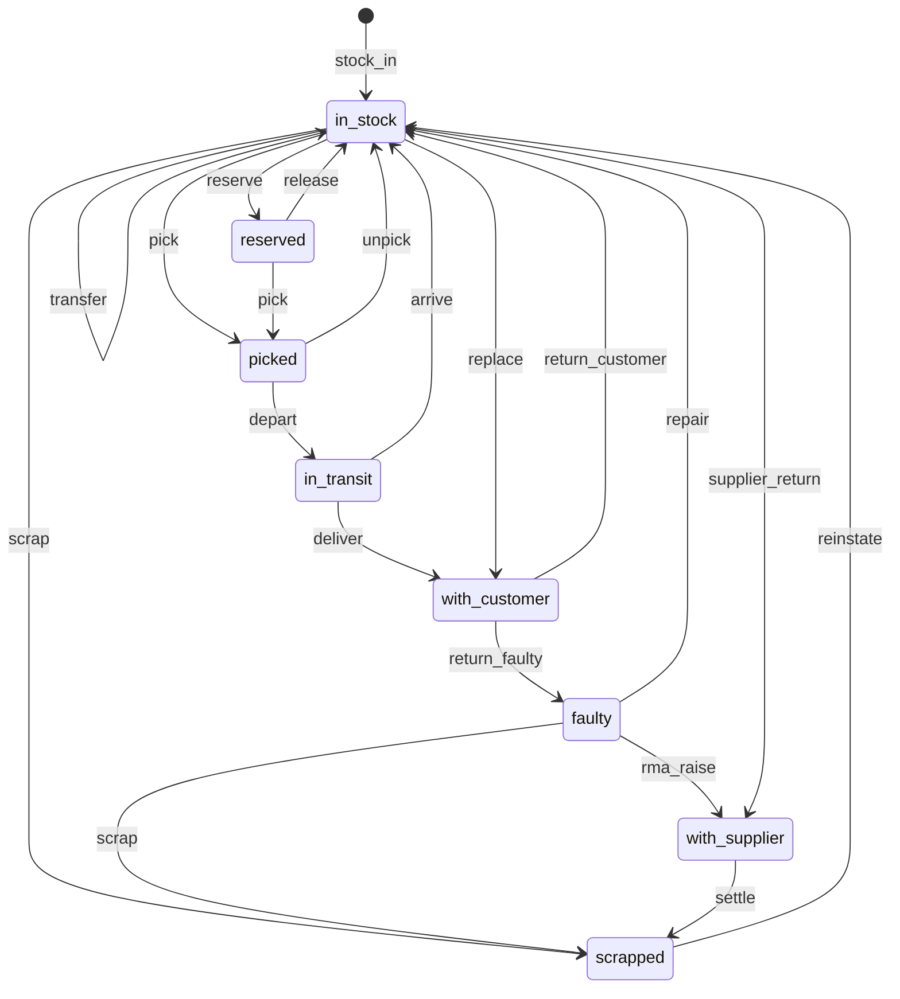

# Serial state machine

<!-- Generated from packages/domain/src/state-machines by `pnpm --filter @shakti/domain machines:docs`. Do not edit by hand. -->

`serials.state`, kept with `serials.bin_id` by the ledger's definer `app.stock_move()` as each movement posts. One serial moves per movement; a serial is in one bin while the company holds it and in none once it has left. R3's installed-base import enters a serial sold before go-live directly as `with_customer`, with no movement.

Sources: docs/03-roadmap-appendix/phase3.md §5, §6.2; BLUEPRINT §8.4; PRD INV-02, INV-08; DATABASE §6.5 `serials`.

Items marked *proposed* are not named in the governing documents; they were chosen for this specification and need review.

## States

| State | Kind | Notes |
|---|---|---|
| `in_stock` | initial | In a bin of a hub, free or held. |
| `reserved` | – | Set aside for an order line (H2). |
| `picked` | – | Moved to the hub's dispatch bin for a dispatch (D2). |
| `in_transit` | – | Left the hub on a dispatch, or between two hubs (D2). |
| `with_customer` | – | Delivered; its warranty runs from the delivery (D2, R3). |
| `faulty` | – | Back from a customer as a fault, in quarantine (R3). |
| `with_supplier` | – | Sent to the supplier under their warranty or returned to them (R3, R2). |
| `scrapped` | – | Written off by an adjustment, damage or a count; a reversal or a later find brings it back. |

## Transitions

| Event | From → To | Permitted actor | Guard | Effects |
|---|---|---|---|---|
| `stock_in` | (new) → `in_stock` | `inventory.stock.adjust` at entity scope or wider | – | `create_serial`: the serial enters the bin of its movement |
| `transfer` | `in_stock` → `in_stock` | `inventory.stock.move` at entity scope or wider | the serial is in the bin the movement takes it from | `move_bin`: the serial's bin becomes the movement's |
| `scrap` | `in_stock`, `faulty` → `scrapped` | `inventory.stock.adjust` at entity scope or wider | the serial is in the bin the movement takes it from | `clear_bin`: the serial leaves its bin |
| `reinstate` | `scrapped` → `in_stock` | `inventory.stock.adjust` at entity scope or wider | – | `move_bin`: the serial's bin becomes the movement's |
| `reserve` *(proposed)* | `in_stock` → `reserved` | `sales.order.confirm` or the platform | – | – |
| `release` *(proposed)* | `reserved` → `in_stock` | `inventory.stock.adjust` at entity scope or wider or the platform | – | – |
| `pick` *(proposed)* | `in_stock`, `reserved` → `picked` | `inventory.dispatch.write` at entity scope or wider | – | – |
| `unpick` *(proposed)* | `picked` → `in_stock` | `inventory.dispatch.write` at entity scope or wider | – | – |
| `depart` *(proposed)* | `picked` → `in_transit` | `inventory.dispatch.write` at entity scope or wider | – | – |
| `arrive` *(proposed)* | `in_transit` → `in_stock` | `inventory.dispatch.write` at entity scope or wider | – | – |
| `deliver` *(proposed)* | `in_transit` → `with_customer` | `inventory.dispatch.write` at entity scope or wider | – | – |
| `replace` *(proposed)* | `in_stock` → `with_customer` | `inventory.stock.move` at entity scope or wider | – | – |
| `return_customer` *(proposed)* | `with_customer` → `in_stock` | `inventory.stock.adjust` at entity scope or wider | – | – |
| `return_faulty` *(proposed)* | `with_customer` → `faulty` | `inventory.warranty.write` at entity scope or wider | – | – |
| `repair` *(proposed)* | `faulty` → `in_stock` | `inventory.stock.adjust` at entity scope or wider | – | – |
| `rma_raise` *(proposed)* | `faulty` → `with_supplier` | `procurement.po.write` at entity scope or wider | – | – |
| `supplier_return` *(proposed)* | `in_stock` → `with_supplier` | `procurement.grn.write` at entity scope or wider | – | – |
| `settle` *(proposed)* | `with_supplier` → `scrapped` | `procurement.grn.write` at entity scope or wider | – | – |

Any other event, or an event from a state not listed for it, answers `conflict` with reason `serial_transition_not_allowed`. A guard that refuses answers its own reason; the permission check answers `forbidden`. No command drives this machine yet; the commands of its phase follow it (ROADMAP §3 onwards).

## Notes

- `stock_in`: Opening stock or an adjustment gain of a new serial number (H1); a goods receipt (U2).
- `transfer`: Moved between two bins of a hub, or back by the reversal of such a move (H1).
- `scrap`: An adjustment loss, damage or a count loss, or the reversal of the movement that brought it in (H1).
- `reinstate`: An adjustment gain or a count of the same serial number, or the reversal of the loss (H1).
- `reserve`: H2: confirming an order, or the backorder fill, sets the serial aside.
- `release`: H2: a released or lapsed reservation frees the serial.
- `pick`: D2: picked by scan into the dispatch bin.
- `unpick`: D2: a cancelled dispatch puts picked stock back.
- `depart`: D2: the dispatch departs through the e-way bill gate.
- `arrive`: D2: a transfer between hubs arrives at the receiving hub.
- `deliver`: D2: delivered with the arrival photo; the warranty runs from today.
- `replace`: R3: issued from stock as a warranty replacement.
- `return_customer`: R2: returned after delivery into quarantine.
- `return_faulty`: R3: the failed serial of a claim comes back into quarantine.
- `repair`: R3: found sound and moved back to storage.
- `rma_raise`: R3: sent to the supplier under their warranty.
- `supplier_return`: R2: returned to the supplier against its receipt.
- `settle`: R3: the supplier's credit or replacement settles it; a replacement is a new serial.

## Diagram

