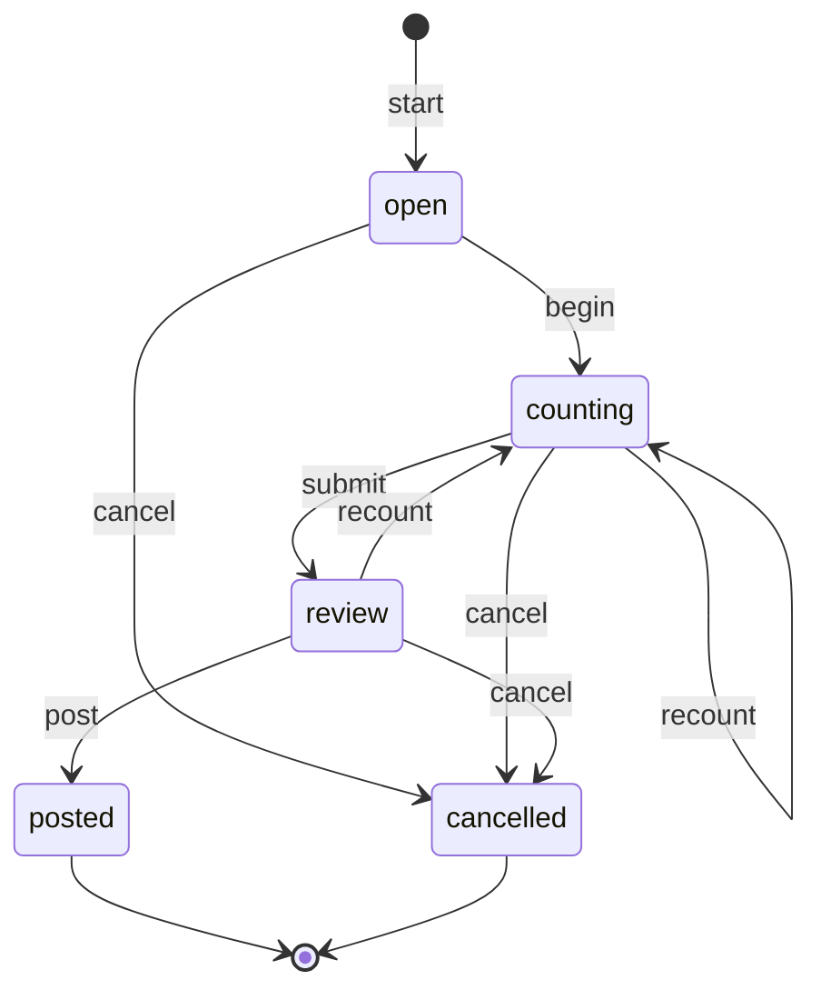

# Stock count state machine

<!-- Generated from packages/domain/src/state-machines by `pnpm --filter @shakti/domain machines:docs`. Do not edit by hand. -->

`stock_counts.state`. One live count (open, counting or review) per company and hub (`stock_counts_live_unique`), so no variance posts twice. A counter's lines are written by the count's definers; the expected quantity is never read by a counter.

Sources: docs/03-roadmap-appendix/phase3.md §7.3; PRD INV-02; DATABASE §6.5 `stock_counts`.

Every state and transition comes from the governing documents.

## States

| State | Kind | Notes |
|---|---|---|
| `open` | initial | Started; the expected quantities are frozen and nobody has counted yet. |
| `counting` | – | Counters are counting, or counting again what the Inventory Manager asked for. |
| `review` | – | Every item in every bin is counted; the Inventory Manager reviews the variances. |
| `posted` | terminal | Each variance became a `count` movement; the ledger equals what was counted. |
| `cancelled` | terminal | Stopped with a reason before it posted; nothing moved. |

## Transitions

| Event | From → To | Permitted actor | Guard | Effects |
|---|---|---|---|---|
| `start` | (new) → `open` | `inventory.stock.adjust` at entity scope or wider | – | `freeze_expected`: `app.stock_count_start()` lists each item and serial in the scope's bins |
| `begin` | `open` → `counting` | `inventory.count.record` at entity scope or wider | – | – |
| `submit` | `counting` → `review` | `inventory.count.record` at entity scope or wider | every item in every bin is counted and no recount is open | – |
| `recount` | `counting`, `review` → `counting` | `inventory.stock.adjust` at entity scope or wider | – | `ask_again`: `app.stock_count_recount()` marks the item's lines |
| `post` | `review` → `posted` | `inventory.stock.adjust` at entity scope or wider | every item in every bin is counted and no recount is open | `post_variances`: each variance becomes a `count` movement through `app.stock_move()` in one batch: a serial found is reinstated, a serial missing is written off with its reason |
| `cancel` | `open`, `counting`, `review` → `cancelled` | `inventory.stock.adjust` at entity scope or wider | – | – |

Any other event, or an event from a state not listed for it, answers `conflict` with reason `stock_count_transition_not_allowed`. A guard that refuses answers its own reason; the permission check answers `forbidden`. The command writes the new state to `stock_counts.state` and the time to `stock_counts.state_changed_at` when the state changes, applies the effects and calls `ctx.audit()`; it emits no event.

## Notes

- `start`: A whole hub, chosen bins or chosen items; refused while the company has a live count in the hub.
- `begin`: The first counter's first count.
- `recount`: One item in one bin, counted again blind; the recount stands once taken.
- `cancel`: With a reason; nothing moves.

## Diagram

