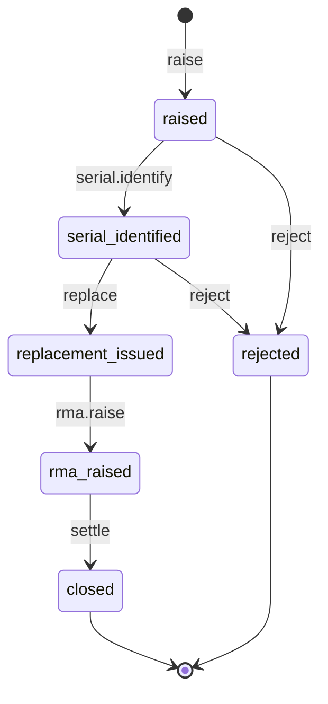

# Warranty claim state machine

<!-- Generated from packages/domain/src/state-machines by `pnpm --filter @shakti/domain machines:docs`. Do not edit by hand. -->

`warranty_claims.state`. Raised on a customer or serial; the replacement comes from stock and the supplier RMA follows. Until job costing exists (Phase 5) the replacement's cost and the supplier's credit stay on the claim's restricted costs (`warranty_claim_costs`, `finance.cost.read`; phase3 §2 question 10 (a)).

Sources: BLUEPRINT §8.4, §19 item 2; PRD INV-08; DATABASE §6.5 `warranty_claims`; docs/03-roadmap-appendix/phase3.md §7.5, §14.

Items marked *proposed* are not named in the governing documents; they were chosen for this specification and need review.

## States

| State | Kind | Notes |
|---|---|---|
| `raised` | initial, *proposed* | Step 1: the claim is raised on a customer or serial. |
| `serial_identified` | *proposed* | Step 2: the failed serial is identified. |
| `replacement_issued` | *proposed* | Step 3: a replacement is issued from stock. |
| `rma_raised` | *proposed* | Step 4: a supplier RMA is raised under the supplier's warranty terms. |
| `closed` | terminal, *proposed* | Step 5: supplier credit or a replacement is received. |
| `rejected` | terminal, *proposed* | Out of warranty or not a fault. |

## Transitions

| Event | From → To | Permitted actor | Guard | Effects | Emits |
|---|---|---|---|---|---|
| `raise` | (new) → `raised` | `inventory.warranty.write` at entity scope or wider | – | – | `inventory.warranty.raised` |
| `serial.identify` | `raised` → `serial_identified` | `inventory.warranty.write` at entity scope or wider | the failed serial is given; the serial's warranty runs to today or later (IST) | `set_serial`: record the failed serial on the claim | `inventory.warranty.serial_identified` |
| `replace` | `serial_identified` → `replacement_issued` | `inventory.warranty.write` at entity scope or wider | the replacement serial is recorded | `issue_stock`: the replacement serial leaves stock to the customer (`warranty_replacement`, at the moving average); `cost_entry`: the replacement's cost on the claim's restricted costs; the job cost entry of type `warranty` waits for Phase 5 (question 10 (a)) | – |
| `rma.raise` | `replacement_issued` → `rma_raised` | `procurement.po.write` at entity scope or wider | the supplier's RMA reference is recorded | – | – |
| `settle` | `rma_raised` → `closed` | `procurement.grn.write` at entity scope or wider | supplier credit or a supplier replacement is received | `adjust_cost`: the supplier's credit on the claim's restricted costs, or its replacement serial received into stock; Phase 5 offsets the job cost entry with it | `inventory.warranty.closed` |
| `reject` *(proposed)* | `raised`, `serial_identified` → `rejected` | `inventory.warranty.write` at entity scope or wider | a reason is given | – | `inventory.warranty.rejected` |

Any other event, or an event from a state not listed for it, answers `conflict` with reason `warranty_claim_transition_not_allowed`. A guard that refuses answers its own reason; the permission check answers `forbidden`. The command writes the new state to `warranty_claims.state` and the time to `warranty_claims.state_changed_at` when the state changes, applies the effects and calls `ctx.audit()`, and emits the event in the *Emits* column ([event catalogue](../data/events.md)).

## Notes

- `raise`: From Account 360, or from the serial reported, whose customer the claim takes.
- `serial.identify`: The serial is the company's, with the claim's customer; out of warranty it is refused with its date, and the claim is rejected.

## Diagram

